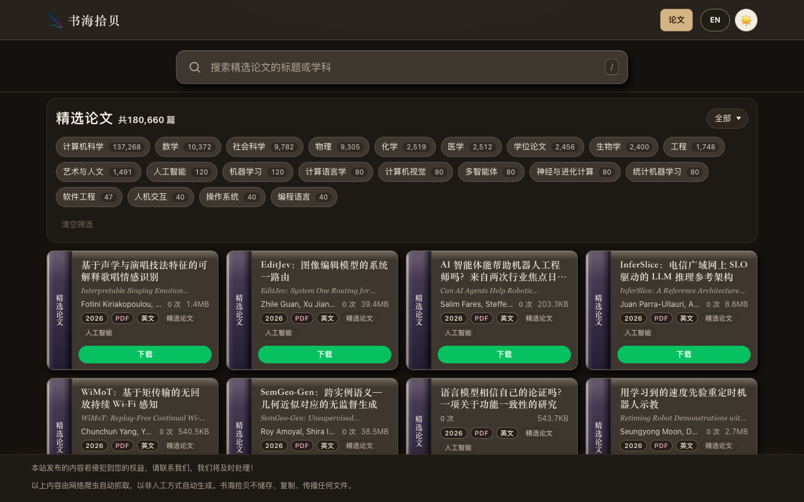

# 精选论文

欢迎来到《精选论文》，收录 180,660 篇论文。英文名是 Selected Papers。无论你在查计算机科学、数学、社会科学、物理，还是化学、医学和工程，这里都能查到。

https://www.embassygrade.com/selected-papers.html



## 打开

请用静态服务器打开。`file://` 只能读取同目录的 `.js` 切片，不能请求点击接口。

```bash
python3 -m http.server 8813
```

然后打开 <http://127.0.0.1:8813/>。

列表数据在 `data/papers/`：目录元数据、分页切片、学科切片和搜索分片，以及给 `file://` 用的 `.js` 副本。页面按切片翻页，不会一次下载全部记录。中文界面在译名是真实标题时显示中文标题；英文界面只显示英文标题。`/api/popular` 和 `/api/clicks` 不在本仓库里；http(s) 下请求失败时会安静跳过，列表仍用这些切片渲染。下载链接来自切片里已有的数据。

许可证待定。
